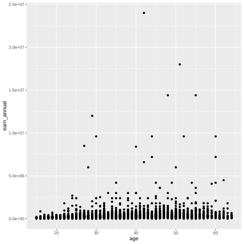
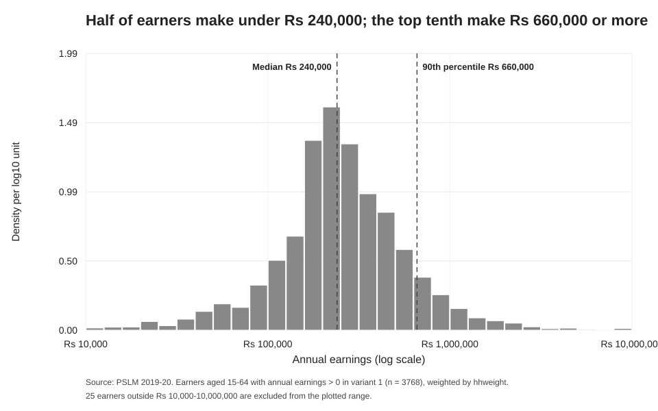
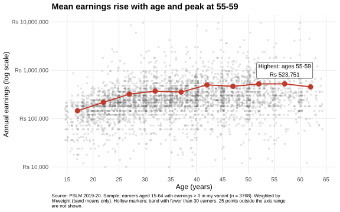
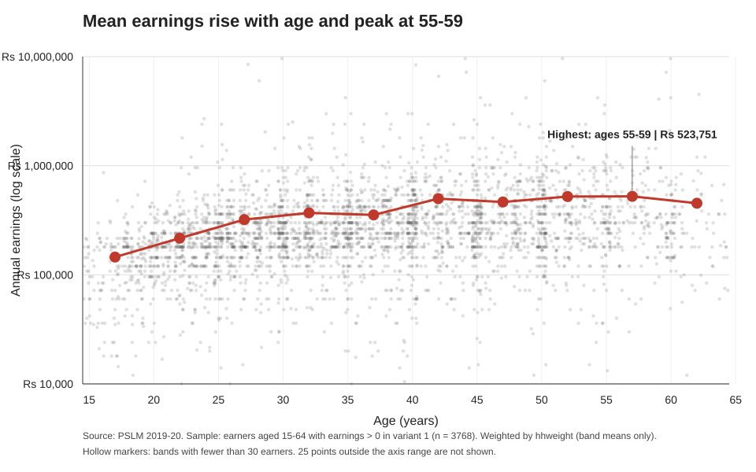

# Who Earns What, and at What Age? Earnings in PSLM 2019-20

**ECO346 Data Visualization and Technical Experiments · Assignment 1, Section A**
**Student:** Ahmad Muaaz · **Reg. no.:** FA24-BED-009 · **GitHub:** [Muaaz-lab](https://github.com/Muaaz-lab)

---

## Overview

This repository studies annual earnings of workers in the Pakistan Social and Living Standards Measurement (PSLM) survey, 2019-20. It answers three questions with figures:

1. **How are earnings distributed?** (weighted histogram)
2. **How do earnings change with age?** (redesigned scatter with weighted band means)
3. **Do the results hold in a second language?** (the same band table and figure rebuilt in Python)

| | |
|---|---|
| **Variant** | 9 mod 8 = **1**, i.e. `prov_code == 2` and `urban_rural == 2` |
| **Sample** | Earners aged 15-64 with annual earnings above zero (**n = 3,768**) |
| **Weights** | `hhweight`, merged from the household file on `hhid` |

---

## Key results

| Statistic | Value |
|---|---|
| Earners (unweighted) | 3,768 |
| Median earnings, weighted / unweighted | Rs 240,000 / Rs 240,000 |
| 10th percentile (weighted) | Rs 96,000 |
| 90th percentile (weighted) | Rs 660,000 |
| P90 / P10 ratio | 6.88 |
| Earners outside Rs 10,000-10,000,000 | 25 (20 below, 5 above) |
| Weighted mean, ages 25-29 | Rs 320,776 |
| Weighted mean, ages 45-49 | Rs 465,073 |
| Age band with the highest mean | **55-59** (Rs 523,751) |

### Weighted mean earnings by age band

| Band | Earners | Weighted mean (Rs) |
|---|---:|---:|
| 15-19 | 229 | 145,444 |
| 20-24 | 449 | 216,585 |
| 25-29 | 499 | 320,776 |
| 30-34 | 518 | 369,580 |
| 35-39 | 498 | 354,031 |
| 40-44 | 435 | 498,966 |
| 45-49 | 427 | 465,073 |
| 50-54 | 363 | 521,949 |
| 55-59 | 220 | 523,751 |
| 60-64 | 130 | 453,067 |

No band has fewer than 30 earners, so no hollow "thin band" markers appear in this variant. The peak is nearly flat between 50 and 59.

---

## Figures

**1. Default scatterplot** (R defaults, committed first, before any redesign)



**2. Distribution of earnings** (weighted, log scale)



**3. Redesign: earnings by age** (R)



**4. The same figure rebuilt in Python**



---

## Repository structure

```
.
├── README.md
├── data/
│   ├── pslm_person_subset.csv
│   └── pslm_hh_subset.csv
├── scripts/
│   ├── 01_default.R             default scatter, nothing changed
│   ├── 02_distribution.R        statistics + weighted histogram
│   ├── 03_relationship.R        band table + redesigned scatter
│   └── 04_second_language.py    band table + figure in Python
├── figures/                     created by the scripts
└── slides/
    └── FA24-BED-009.pptx
```

---

## How to reproduce

Run everything from the **repository root** (the folder containing `data/`).

```bash
# R (version 4.1 or newer, for the |> pipe)
Rscript scripts/01_default.R
Rscript scripts/02_distribution.R
Rscript scripts/03_relationship.R

# Python
python scripts/04_second_language.py
```

**Requirements**

- R: `readr`, `dplyr`, `ggplot2`, `svglite`
- Python: standard library only

Run order matters: run 04 after 03 so the Python script can compare its table with the R output. Scripts do not download packages or data. Install the listed R packages before going offline; the Python script uses only the standard library.

---

## Method

- **Sample.** Person file merged to the household file on `hhid`. Keep ages 15-64, `earn_annual > 0`, and the variant's province and area.
- **Weighted quantiles** (the paper's definition). Sort by earnings, compute the cumulative share of weight, and take the smallest earnings value whose share reaches or exceeds *p*. R's built-in `quantile()` is not used.
- **Weighted band mean.** For each five-year age band, `sum(hhweight × earnings) / sum(hhweight)`, rounded to whole rupees and plotted at the band midpoint.
- **Histogram.** Weighted density on a log10 axis, 30 bins of width 0.1 between Rs 10,000 and Rs 10,000,000. Earners outside that range are excluded and counted in the caption.
- **Reproducibility.** Jitter uses a fixed seed (346) and moves points sideways only (at most 0.4 years), since age is recorded in whole years.

---

## Design choices in the redesign

| Change | Why |
|---|---|
| Log y-axis with rupee labels | Earnings are heavily right-skewed; a log scale spreads the mass and avoids `1e+07` notation |
| Transparent, jittered points | Reduces overplotting so density is visible |
| Weighted band-mean line | Summarises the trend using the survey weights |
| Hollow markers for thin bands | Flags estimates based on fewer than 30 earners |
| Direct label on the peak, descriptive title, source caption | States the message and the sample rather than leaving the reader to infer it |
| Grey panel and minor gridlines removed | Less clutter |

**What the redesign hides:** the 5 earners above Rs 10,000,000 (up to Rs 24,000,000) and 20 below Rs 10,000 that the default shows. The figure's caption states how many points are off the axis.

---

## Notes and limitations

- **Cross-section, not a life path.** Band means compare different people at one point in time, so the figure cannot show how any individual's earnings change with age.
- **Heaping at round numbers.** About 7% of earners report exactly Rs 240,000 (Rs 20,000 × 12). This spike sits on the 50th percentile, which is why the weighted and unweighted medians are identical.
- **Python vs R.** The band tables agree to the rupee. Python independently rebuilds the relationship figure as SVG; marker placement and styling can differ slightly from R.

---

*Data: PSLM 2019-20 subset provided for the course.*
